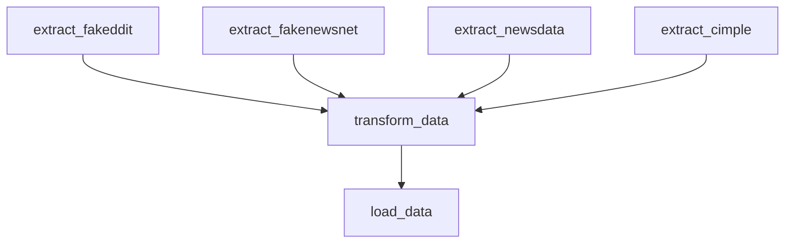

# Étape 4 — Orchestration du pipeline avec Apache Airflow

## 1. Objectif

Cette étape consiste à automatiser le pipeline ETL CheckIt.AI avec Apache Airflow.

Le DAG orchestre les différentes étapes du traitement des données :

- Extraction depuis les quatre sources de données.
- Transformation et normalisation des données.
- Chargement des données transformées dans une base relationnelle SQLite.

L'objectif est de disposer d'un pipeline automatisé, modulaire, reproductible et vérifiable.

## 2. Environnement technique

| Composant | Version ou configuration |
|---|---|
| Système d'exploitation | Ubuntu 24.04.3 LTS |
| Python | 3.11 |
| Gestion des environnements | uv |
| Apache Airflow | 3.4.0 |
| Opérateur Airflow | PythonOperator |
| Base de données cible | SQLite |
| Mode d'exécution | Local sur serveur Linux |

Airflow est installé dans un environnement virtuel indépendant du projet afin de ne pas modifier l'environnement Python utilisé par les connecteurs d'extraction et le pipeline de transformation.

Cette séparation permet de conserver les dépendances propres à chaque environnement.

## 3. Installation et configuration d'Airflow

### 3.1. Création de l'environnement virtuel

L'environnement Airflow est créé séparément de celui du projet :

```bash
uv venv --python 3.11 /mnt/projects/envs/airflow
```

### 3.2. Installation d'Apache Airflow

Installation de la version 3.4.0 avec les contraintes officielles correspondant à Python 3.11 :

```bash
uv pip install \
  --python /mnt/projects/envs/airflow/bin/python \
  "apache-airflow==3.4.0" \
  --constraint "https://raw.githubusercontent.com/apache/airflow/constraints-3.4.0/constraints-3.11.txt"
```

La compatibilité des dépendances a été vérifiée avec :

```bash
uv pip check --python /mnt/projects/envs/airflow/bin/python
```

Résultat : toutes les dépendances installées sont compatibles.

### 3.3. Configuration des variables d'environnement

Les variables suivantes permettent de définir le répertoire de travail d'Airflow et l'emplacement du DAG :

```bash
export AIRFLOW_HOME=/mnt/projects/envs/airflow_home

export AIRFLOW__CORE__DAGS_FOLDER=/mnt/projects/vk_oc_projet12_checkitai-multimodal-etl/airflow/dags

export PATH="/mnt/projects/envs/airflow/bin:$PATH"
```

### 3.4. Initialisation de la base interne Airflow

```bash
airflow db migrate
```

### 3.5. Démarrage d'Airflow

Le service est démarré localement avec :

```bash
airflow standalone
```

L'interface web est accessible depuis le poste local grâce à un tunnel SSH :

```bash
ssh -N -L 8080:127.0.0.1:8080 vikenserver@192.168.1.26
```

L'adresse IP du serveur peut varier selon le réseau local.

L'interface Airflow est accessible à l'adresse :

[http://localhost:8080](http://localhost:8080)

## 4. Architecture du DAG

### 4.1. Identification

- **Identifiant du DAG :** `checkitai_etl_pipeline`
- **Fichier :** `airflow/dags/checkitai_etl_dag.py`
- **Opérateur utilisé :** `PythonOperator`
- **Déclenchement :** manuel
- **Planification automatique :** désactivée (`schedule=None`)
- **Rattrapage des exécutions passées :** désactivé (`catchup=False`)

### 4.2. Organisation des tâches

Le DAG comprend six tâches distinctes :

| Tâche | Fonction |
|---|---|
| `extract_fakeddit` | Extraction des données Fakeddit |
| `extract_fakenewsnet` | Extraction des données FakeNewsNet |
| `extract_newsdata` | Extraction des articles NewsData.io |
| `extract_cimple` | Extraction des vérifications CIMPLE KG |
| `transform_data` | Transformation et normalisation des données |
| `load_data` | Chargement dans la base SQLite |

Les quatre tâches d'extraction sont indépendantes et peuvent être exécutées en parallèle.

Elles convergent vers la tâche `transform_data`, qui attend leur achèvement.

Enfin, `load_data` s'exécute après la réussite de la transformation.

### 4.3. Graphe des dépendances



Cette organisation garantit le respect de l'ordre des opérations ETL.

### 4.4. Réutilisation des modules existants

Le DAG réutilise les modules Python développés lors des étapes précédentes du projet.

Les scripts d'extraction, de transformation et de chargement sont exécutés dans l'environnement Python du projet au moyen de sous-processus.

Cette approche présente plusieurs avantages :

- Éviter de dupliquer le code métier.
- Conserver les dépendances propres au projet.
- Faciliter la maintenance des connecteurs.
- Séparer l'orchestration Airflow du traitement des données.

## 5. Base de données cible

### 5.1. Choix de SQLite

SQLite a été retenu comme solution de stockage relationnelle pour cette démonstration locale.

La base de données est enregistrée à l'emplacement suivant :

`/mnt/data/vk_oc_projet12_checkitai-multimodal-etl/processed/checkitai.db`

Ce choix permet de disposer d'une base persistante sans installer un serveur de base de données supplémentaire.

### 5.2. Modèle relationnel

La base comporte quatre tables principales :

| Table | Rôle |
|---|---|
| `sources` | Référentiel des sources de données |
| `content_records` | Publications et métadonnées |
| `image_assets` | Informations relatives aux images |
| `label_assessments` | Labels et évaluations associés |

Les relations entre les tables sont assurées par des clés primaires et étrangères.

Les clés étrangères sont activées pendant le chargement.

### 5.3. Chargement des données

Le module `src/checkitai/storage/sqlite_loader.py` assure le chargement des fichiers transformés dans SQLite.

Le chargement utilise des opérations UPSERT afin de permettre la réexécution du traitement sans créer de doublons pour les identifiants existants.

Le fichier de base de données dispose des permissions Unix `600`, limitant son accès au propriétaire du fichier.

## 6. Résultats de l'exécution du DAG

### 6.1. Exécution dans Airflow

Le DAG `checkitai_etl_pipeline` a été déclenché manuellement depuis l'interface web Airflow.

Résultat observé :

- 6 tâches exécutées avec succès.
- 0 tâche en échec.
- Les quatre extractions ont été réalisées avant la transformation.
- Le chargement SQLite s'est terminé avec succès.

L'exécution a été visualisée dans la vue Grid d'Airflow.

### 6.2. Volume de données chargé

La vérification de la base de données après exécution a donné les résultats suivants :

| Source | Nombre de publications |
|---|---:|
| Fakeddit | 100 |
| FakeNewsNet | 40 |
| NewsData.io | 20 |
| CIMPLE KG | 800 |
| **Total** | **960** |

Les volumes présentés correspondent aux données réellement présentes dans la base après l'exécution.

Le nombre de 20 articles pour NewsData.io correspond au résultat observé, supérieur à l'estimation initiale de 10 articles.

### 6.3. Contrôles d'intégrité

Les contrôles suivants ont été effectués :

| Contrôle | Résultat |
|---|---|
| Intégrité SQLite (`PRAGMA integrity_check`) | `ok` |
| Vérification des clés étrangères (`PRAGMA foreign_key_check`) | Aucune erreur |
| Nombre de sources | 4 |
| Nombre de publications | 960 |
| Nombre d'images associées | 960 |
| Nombre d'évaluations associées | 960 |

Ces contrôles confirment que les données ont été chargées correctement et que les relations référentielles sont cohérentes.

## 7. Preuves d'exécution

Les éléments de preuve sont conservés dans le projet et dans son répertoire de données.

### 7.1. Capture de l'interface Airflow

La capture de la vue Grid présentant les six tâches en succès est enregistrée dans :

`docs/captures/airflow_dag_success.png`

### 7.2. Rapport de contrôle SQLite

Le rapport de vérification de la base est enregistré dans :

`/mnt/data/vk_oc_projet12_checkitai-multimodal-etl/reports/controle_bdd_etape4.txt`

Il contient les résultats des contrôles d'intégrité, les volumes chargés et la répartition par source.

## 8. Sécurité et limites techniques

Plusieurs précautions ont été prises pour cette démonstration :

- L'accès à l'interface Airflow s'effectue au moyen d'un tunnel SSH.
- Le fichier SQLite dispose de permissions Unix `600`.
- Les clés API sont conservées dans un fichier `.env` non versionné.
- L'environnement Airflow est isolé de l'environnement Python du projet.

Cependant, cette architecture présente certaines limites.

SQLite ne fournit pas de gestion native des utilisateurs et des rôles, ni de chiffrement natif de la base de données.

La protection repose ici sur les permissions du système de fichiers et la sécurité du serveur hôte.

Cette solution convient à une démonstration locale et à un projet pédagogique, mais ne constitue pas une architecture de production.

Pour un déploiement en production, une base de données serveur avec authentification, gestion des rôles et chiffrement serait à privilégier.

## 9. Conclusion

L'étape 4 a permis d'intégrer Apache Airflow au projet CheckIt.AI afin d'orchestrer le pipeline ETL.

Le DAG `checkitai_etl_pipeline` comporte six tâches distinctes et respecte les dépendances entre les étapes d'extraction, de transformation et de chargement.

Une exécution complète a été réalisée avec succès depuis l'interface Airflow :

- Six tâches réussies.
- Aucune tâche en échec.
- 960 publications chargées dans SQLite.
- Intégrité de la base confirmée.
- Aucune erreur de clé étrangère.

Le pipeline est ainsi orchestré et exécutable localement avec Apache Airflow. Les preuves d'exécution et les résultats des contrôles sont conservés pour faciliter la vérification du travail réalisé.

